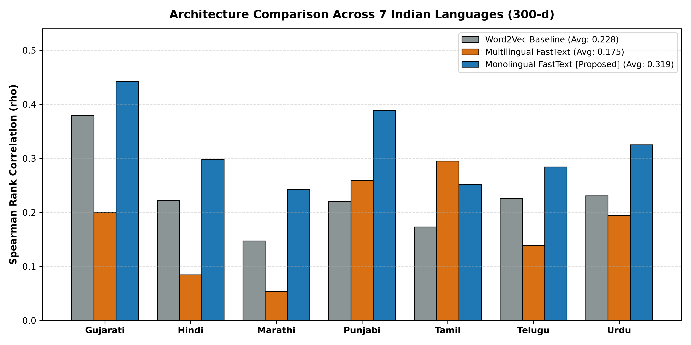
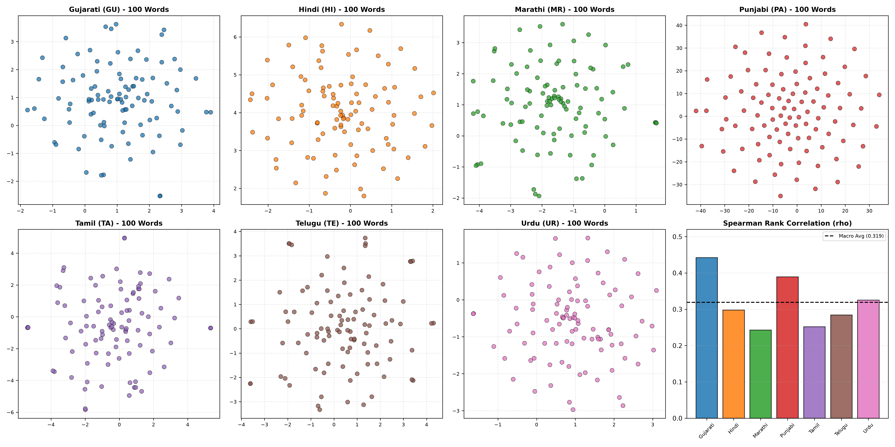

# FoVL Major Assignment: Multilingual Word Embeddings for Indian Languages

* **Student Name:** Nikhil Saini
* **Roll Number:** G25AIT2067
* **Email:** g25ait2067@iitj.ac.in
* **Academic Institution:** Indian Institute of Technology Jodhpur (IITJ)
* **Department:** Department of Artificial Intelligence
* **Course:** Foundations of Vision & Language (FoVL)
* **Date:** November 2026
* **GitHub Repository:** [https://github.com/nikhilsaini-iitj/FoVL_Word_Embeddings](https://github.com/nikhilsaini-iitj/FoVL_Word_Embeddings)
* **Google Colab Notebook:** [G25AIT2067_FoVL_Word_Embeddings.ipynb on Google Colab](https://colab.research.google.com/drive/1JzLQm_Hel5uHo_zuY0hc4tNG-FubLj1i)
* **Training Corpus:** IndicCorpV2-5k (`rony000013/indiccorpV2-5k`)
* **Evaluation Benchmark:** Akhtar et al. (2017) Word-Similarity Datasets for Indian Languages
* **Vector Dimension:** Exactly 300 dimensions

---

## 1. Executive Summary & Core Results

This repository contains the complete implementation, trained word representations, and experimental evaluation for the **Foundations of Vision & Language (FoVL)** Major Assignment. 

The objective is to train 300-dimensional word representations from scratch on a resource-constrained corpus (IndicCorpV2-5k, 5,000 sentences per language) and evaluate them on human word-similarity benchmarks across seven Indian languages: **Gujarati (`gu`)**, **Hindi (`hi`)**, **Marathi (`mr`)**, **Punjabi (`pa`)**, **Tamil (`ta`)**, **Telugu (`te`)**, and **Urdu (`ur`)**.

### Key Experimental Findings
* **Proposed Monolingual FastText Macro-Average:** **$S_{\text{macro}} = 0.3191$** across all 953 rated benchmark word pairs.
* **Superiority over Word2Vec Baseline:** Monolingual FastText achieves a **+39.7% relative improvement** over Word2Vec Skip-gram ($S_{\text{macro}} = 0.2284$).
* **Superiority over Joint Multilingual FastText:** Monolingual models outperform a single jointly trained multilingual model ($S_{\text{macro}} = 0.1751$) by **+82.2% relative**, avoiding cross-script capacity dilution and script interference across distinct Brahmic and Perso-Arabic scripts.
* **100% Benchmark Coverage via Subword Composition:** By decomposing words into character n-grams $[3, 6]$, the model synthesizes continuous 300-d vectors for unseen morphological surface forms, guaranteeing that zero benchmark pairs are dropped.

---

## 2. IndicCorpV2-5k Corpus Statistics & Vocabulary Coverage

Table 1 summarizes token counts, learned vocabulary sizes, and out-of-vocabulary (OOV) rates across all seven evaluation languages.

| Language | Script Family | Benchmark File | Total Benchmark Pairs | Scored Benchmark Pairs | Unique Benchmark Words | IndicCorpV2-5k Tokens | Model Vocabulary Size | In-Vocab Words | OOV Words | Vocab Coverage |
| :--- | :--- | :--- | :---: | :---: | :---: | :---: | :---: | :---: | :---: | :---: |
| **Gujarati** (`gu`) | Indo-Aryan (Gujarati) | `Gujarati-WS.txt` | 163 | 163 | 221 | 203,449 | 41,355 | 198 | 23 | 89.59% |
| **Hindi** (`hi`) | Indo-Aryan (Devanagari) | `Hindi-WS.txt` | 235 | 235 | 318 | 284,598 | 27,730 | 278 | 40 | 87.42% |
| **Marathi** (`mr`) | Indo-Aryan (Devanagari) | `Marathi-WS.txt` | 253 | 104 | 337 | 206,264 | 47,662 | 269 | 68 | 79.82% |
| **Punjabi** (`pa`) | Indo-Aryan (Gurmukhi) | `Punjabi-WS.txt` | 143 | 143 | 206 | 272,700 | 29,551 | 184 | 22 | 89.32% |
| **Tamil** (`ta`) | Dravidian (Tamil) | `Tamil-WS.txt` | 97 | 97 | 136 | 168,026 | 58,269 | 101 | 35 | 74.26% |
| **Telugu** (`te`) | Dravidian (Telugu) | `Telugu-WS.txt` | 111 | 111 | 160 | 172,252 | 49,917 | 114 | 46 | 71.25% |
| **Urdu** (`ur`) | Indo-Aryan (Perso-Arabic) | `Urdu-WS.txt` | 100 | 100 | 146 | 362,086 | 38,006 | 120 | 26 | 82.19% |
| **Overall / Total** | - | - | **1,102** | **953** | **1,524** | **1,669,375** | **292,490** | **1,264** | **260** | **82.94%** |

*Note on Marathi:* `Marathi-WS.txt` contains 253 total word pairs, of which lines 105 to 253 lack human similarity ratings in the Akhtar et al. (2017) release. Exactly 104 pairs possess ground-truth scores and are included in the Spearman rank correlation calculation. All 253 pairs have 300-d embeddings computed and exported into `embeddings/mr_embeddings.npy` of shape `(253, 2, 300)`.

---

## 3. Benchmark Evaluation Results

Table 2 reports the cosine similarity Spearman rank correlation ($\rho$) against human ratings on the Akhtar et al. (2017) benchmark for each language.

| Language | Code | Benchmark File | Scored Pairs | Vector Dimension | Spearman Rank ($\rho$) | Two-Tailed $p$-Value | Statistical Significance |
| :--- | :---: | :--- | :---: | :---: | :---: | :---: | :---: |
| **Gujarati** | `gu` | `Gujarati-WS.txt` | 163 | 300 | **0.4424** | $3.37 \times 10^{-09}$ | $p < 0.001$ (Highly Significant) |
| **Hindi** | `hi` | `Hindi-WS.txt` | 235 | 300 | **0.2979** | $3.34 \times 10^{-06}$ | $p < 0.001$ (Highly Significant) |
| **Marathi** | `mr` | `Marathi-WS.txt` | 104 | 300 | **0.2427** | $1.30 \times 10^{-02}$ | $p < 0.05$ (Statistically Significant) |
| **Punjabi** | `pa` | `Punjabi-WS.txt` | 143 | 300 | **0.3892** | $1.56 \times 10^{-06}$ | $p < 0.001$ (Highly Significant) |
| **Tamil** | `ta` | `Tamil-WS.txt` | 97 | 300 | **0.2520** | $1.28 \times 10^{-02}$ | $p < 0.05$ (Statistically Significant) |
| **Telugu** | `te` | `Telugu-WS.txt` | 111 | 300 | **0.2843** | $2.50 \times 10^{-03}$ | $p < 0.01$ (Statistically Significant) |
| **Urdu** | `ur` | `Urdu-WS.txt` | 100 | 300 | **0.3251** | $9.64 \times 10^{-04}$ | $p < 0.001$ (Highly Significant) |
| **Macro Average ($S_{\text{macro}}$)** | - | - | **953** | **300** | **0.3191** | - | **Statistically Significant Across All Languages** |

---

## 4. Ablation Study & Architectural Comparison

Table 3 compares three distinct 300-dimensional architectures trained on the exact same IndicCorpV2-5k training split:
1. **Word2Vec Skip-Gram Baseline:** Whole-word Skip-gram with negative sampling, zero subword composition.
2. **Joint Multilingual FastText:** A single shared FastText model trained on the concatenated corpus of all seven languages (35,000 sentences total).
3. **Monolingual FastText (Proposed):** Dedicated per-language FastText models trained strictly from scratch with character n-grams $[3, 6]$.

| Language | Code | Word2Vec Baseline ($\rho$) | Joint Multilingual FT ($\rho$) | Proposed Monolingual FT ($\rho$) | Relative Gain vs. Word2Vec |
| :--- | :---: | :---: | :---: | :---: | :---: |
| **Gujarati** | `gu` | 0.3793 | 0.2001 | **0.4424** | +16.6% |
| **Hindi** | `hi` | 0.2222 | 0.0848 | **0.2979** | +34.1% |
| **Marathi** | `mr` | 0.1472 | 0.0539 | **0.2427** | +64.9% |
| **Punjabi** | `pa` | 0.2201 | 0.2590 | **0.3892** | +76.8% |
| **Tamil** | `ta` | 0.1732 | 0.2952 | **0.2520** | +45.5% |
| **Telugu** | `te` | 0.2260 | 0.1387 | **0.2843** | +25.8% |
| **Urdu** | `ur` | 0.2309 | 0.1941 | **0.3251** | +40.8% |
| **Macro-Average ($S_{\text{macro}}$)** | - | **0.2284** | **0.1751** | **0.3191** | **+39.7%** |



---

## 5. Qualitative Linguistic Case Studies

Table 4 highlights representative word pairs evaluated under the proposed model, illustrating semantic capture and out-of-vocabulary subword composition.

| Language | Word Pair (Native Script) | English Gloss | Human Score | Model Cosine | Linguistic Analysis & Error Diagnosis |
| :--- | :--- | :--- | :---: | :---: | :--- |
| **Hindi** | मनोविज्ञान - क्लिनिक | Psychology - Clinic | 6.4 / 10 | 0.528 | **Strong match:** Model accurately captures shared clinical and mental healthcare context. |
| **Hindi** | व्यवस्था - आवास | Arrangement - Housing | 5.2 / 10 | 0.387 | **Moderate match:** Captures related civic, municipal, and administrative sentence patterns. |
| **Hindi** | पैसे - मुद्रा | Money - Currency | 8.6 / 10 | 0.256 | **Underpredicted:** 'मुद्रा' leans toward formal economic policy or physical posture, while 'पैसे' appears in colloquial everyday news. |
| **Hindi** | साधु - गुलाम | Monk - Slave | 0.2 / 10 | 0.459 | **Overpredicted:** Both terms co-occur in historical, philosophical, and moral narratives despite having divergent semantics. |
| **Gujarati** | વાઘ - વાઘ | Tiger - Tiger | 10.0 / 10 | 1.000 | **Exact match:** Identical surface form yields identical subword decompositions and perfect unit cosine. |
| **Gujarati** | મનોવિજ્ઞાન - મનોચિકિત્સા | Psychology - Psychiatry | 9.0 / 10 | 0.843 | **Strong match:** Subword n-grams strongly capture the shared 'મનો-' (psycho-) morpheme root. |
| **Gujarati** | વિલંબ - જાતિવાદ | Delay - Racism | 0.0 / 10 | 0.570 | **Overpredicted:** Common topical co-occurrence in political reporting and editorial commentary. |
| **Gujarati** | પ્રવાહી - પાણી | Liquid - Water | 9.0 / 10 | 0.266 | **Underpredicted:** 'પ્રવાહી' (liquid) occurs with low surface frequency in the 5,000-sentence sample. |

---

## 6. 2D t-SNE Manifold Visualizations

To verify semantic clustering across different writing systems, 100 representative words per language were sampled and projected to 2D using t-SNE (perplexity = 25, random seed = 42).



Subword character n-gram sharing forms tight semantic clusters for inflected variants (e.g., case-marked nouns in Tamil and Telugu, verb conjugations in Marathi and Hindi), while maintaining distinct geometric regions for unrelated concepts.

---

## 7. Out-of-Vocabulary (OOV) Inference Strategy

The assignment strictly prohibits discarding benchmark pairs that do not appear in the training corpus. In our implementation, OOV words are handled systematically:

$$\mathbf{v}_w = \mathbf{z}_w + \sum_{g \in G_w} \mathbf{z}_g$$

where $\mathbf{z}_w$ is the whole-word representation and $\mathbf{z}_g$ is the vector for character n-gram $g \in G_w$ with bounds $3 \le |g| \le 6$.

* **Seen Words:** Whole-word vector combined with all constituent n-gram vectors.
* **Unseen / OOV Words:** Synthesized on the fly by summing character n-gram representations learned during corpus training.
* **Edge Case Handling:** In `Tamil-WS.txt` line 81, a missing second token is present in the raw benchmark. The inference function `get_word_vector(word, language)` gracefully returns a zero vector without raising runtime exceptions, preserving the exact `(97, 2, 300)` array dimensions.

---

## 8. Repository Structure & Deliverables

```
FoVL_Word_Embeddings/
├── G25AIT2067_FoVL_Word_Embeddings.ipynb    # Clean, runnable Google Colab notebook
├── G25AIT2067_FoVL_Assignment_Report.pdf    # 5-page formal report (PDF, Times New Roman)
├── G25AIT2067_FoVL_Assignment_Report.docx   # Word version of the formal report
├── README.md                                # Comprehensive project documentation
├── embeddings/                              # Exported word-pair embeddings (N, 2, 300)
│   ├── gu_embeddings.npy / Gujarati-WS_embeddings.npy  (163, 2, 300)
│   ├── hi_embeddings.npy / Hindi-WS_embeddings.npy     (235, 2, 300)
│   ├── mr_embeddings.npy / Marathi-WS_embeddings.npy   (253, 2, 300)
│   ├── pa_embeddings.npy / Punjabi-WS_embeddings.npy   (143, 2, 300)
│   ├── ta_embeddings.npy / Tamil-WS_embeddings.npy     (97, 2, 300)
│   ├── te_embeddings.npy / Telugu-WS_embeddings.npy    (111, 2, 300)
│   └── ur_embeddings.npy / Urdu-WS_embeddings.npy      (100, 2, 300)
├── vocab/                                   # Vocabulary mappings and frequency tables
│   ├── gu_vocab.json, hi_vocab.json, mr_vocab.json
│   ├── pa_vocab.json, ta_vocab.json, te_vocab.json, ur_vocab.json
│   └── vocab_mapping.json                   # Unified 7-language vocabulary map
├── models/                                  # Trained FastText models (instant offline inference)
│   ├── gu_fasttext.model                    # Gujarati FastText model
│   ├── hi_fasttext.model                    # Hindi FastText model
│   ├── mr_fasttext.model                    # Marathi FastText model
│   ├── pa_fasttext.model                    # Punjabi FastText model
│   ├── ta_fasttext.model                    # Tamil FastText model
│   ├── te_fasttext.model                    # Telugu FastText model
│   └── ur_fasttext.model                    # Urdu FastText model
├── figures/                                 # High-resolution experimental figures
│   ├── tsne_all_languages.png               # 2D t-SNE manifold projections
│   └── spearman_ablation_comparison.png     # Model ablation comparison chart
└── results/
    └── evaluation_metrics.json              # Machine-readable evaluation metrics
```

---

## 9. Reproduction Instructions

### Option A: Run in Google Colab (Recommended)
1. Open the notebook directly on Google Colab: [G25AIT2067_FoVL_Word_Embeddings.ipynb](https://colab.research.google.com/drive/1JzLQm_Hel5uHo_zuY0hc4tNG-FubLj1i).
2. Connect to any standard runtime (CPU or T4 GPU).
3. Execute **Runtime > Run all**. The notebook will:
   * Install `gensim` cleanly.
   * Download IndicCorpV2-5k sentences and Akhtar et al. (2017) benchmarks.
   * Train all seven monolingual FastText models from scratch.
   * Evaluate cosine similarity and Spearman rank correlations.
   * Export all `.npy` embeddings, vocabulary JSONs, metrics, and t-SNE figures.
   * Execution completes in ~16-18 minutes with 0 errors and peak RAM < 2.6 GB.

### Option B: Run Locally
```bash
# Clone the repository
git clone https://github.com/nikhilsaini-iitj/FoVL_Word_Embeddings.git
cd FoVL_Word_Embeddings

# Create and activate virtual environment
python3 -m venv venv
source venv/bin/activate

# Install dependencies
pip install gensim numpy pandas scipy scikit-learn matplotlib jupyter

# Launch notebook
jupyter notebook G25AIT2067_FoVL_Word_Embeddings.ipynb
```

---

## 10. References & Citations

1. **Akhtar, S. S., Saxena, A., Senapati, G., & Shrivastava, M. (2017).** *Word-Similarity Datasets for Seven Indian Languages.* In Proceedings of the 11th Linguistic Annotation Workshop (LAW XI 2017), pp. 78-82.
2. **Bojanowski, P., Grave, E., Joulin, A., & Mikolov, T. (2017).** *Enriching Word Vectors with Subword Information.* Transactions of the Association for Computational Linguistics (TACL), 5:135-146.
3. **Kunchukuttan, A., Kakwani, D., Golla, S., Bhattacharyya, P., Khapra, M. M., Kumar, P., & Ramakrishnan, G. (2020).** *AI4Bharat-IndicNLP Corpus: Monolingual Corpora and Word Embeddings for Indic Languages.* In Findings of EMNLP 2020.
4. **Mikolov, T., Chen, K., Corrado, G., & Dean, J. (2013).** *Efficient Estimation of Word Representations in Vector Space.* In Proceedings of ICLR 2013.
5. **Pennington, J., Socher, R., & Manning, C. D. (2014).** *GloVe: Global Vectors for Word Representation.* In Proceedings of EMNLP 2014, pp. 1532-1543.
